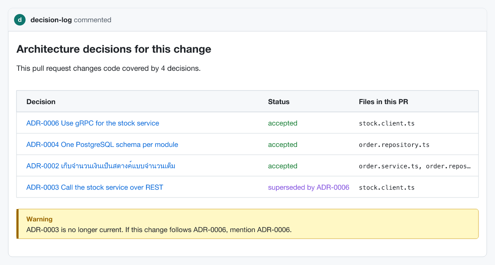

# decision-log

English | [ภาษาไทย](README.th.md)

Architecture decision records that people actually read, because they show up in the pull requests they govern.

[](https://github.com/nuttakulsv/decision-log/actions/workflows/ci.yml)
[](https://www.npmjs.com/package/decision-log-cli)
[](LICENSE)



<sub>The comment the Action posts on a pull request in [examples/shop-api](examples/shop-api) that touches the stock client and the orders module. Drawn from the same data the Action uses.</sub>

```bash
npx decision-log-cli init
npx decision-log-cli new "Use PostgreSQL for orders" --area "src/orders/**"
npx decision-log-cli affected --base origin/main
```

## What it looks like

From [examples/shop-api](examples/shop-api), a small backend with eight decisions:

```console
$ npx decision-log-cli list
ID        STATUS      DATE        TITLE
ADR-0001  accepted    2024-05-06  Record architecture decisions
ADR-0002  accepted    2024-05-20  เก็บจำนวนเงินเป็นสตางค์แบบจำนวนเต็ม
ADR-0003  superseded  2024-06-03  Call the stock service over REST
ADR-0004  accepted    2024-08-12  One PostgreSQL schema per module
ADR-0005  superseded  2024-09-02  Send order notifications with LINE Notify
ADR-0006  accepted    2025-01-20  Use gRPC for the stock service
ADR-0007  accepted    2025-02-10  Send notifications with the LINE Messaging API
ADR-0008  deprecated  2026-05-18  Cache product prices in Redis

$ npx decision-log-cli affected src/clients/stock.client.ts src/orders/order.service.ts
ADR-0006  accepted  Use gRPC for the stock service
    src/clients/stock.client.ts
ADR-0002  accepted  เก็บจำนวนเงินเป็นสตางค์แบบจำนวนเต็ม
    src/orders/order.service.ts
ADR-0003  superseded by ADR-0006  Call the stock service over REST
    src/clients/stock.client.ts

$ npx decision-log-cli check
8 decisions, 0 errors, 0 warnings
```

Each decision says which code it governs with globs in its frontmatter:

```yaml
---
status: accepted
date: 2025-01-20
deciders: [Arm, Ploy]
supersedes: [3]
areas:
  - src/clients/**
---
# Use gRPC for the stock service
```

## Why

Most teams that try ADRs end up with a folder of good documents that nobody opens. The decision gets made, the record gets written, and six months later someone rewrites the stock client to use REST again because they never saw ADR-0006.

The problem is not the format, it's that the record lives in a different place from the work. decision-log connects the two: every decision lists the files it governs, and when a pull request changes those files, the decision is right there in the PR. If the code is still governed by a decision that was replaced, the comment says so, and with `fail-on-deprecated` the check fails until the author acknowledges the current one.

The rest is the boring tooling you need to keep a decision log healthy: a CLI to create and supersede records, a linter for CI, and a static site for browsing.

## Install

```bash
npm install --save-dev decision-log-cli
npx decision-log-cli --help
```

The command it installs is `decision-log`, so in `package.json` scripts you can write `"adr": "decision-log"`. Use the package name with `npx`: a different package is published under the name `decision-log`.

Node.js 20 or newer. The package has three small dependencies (`yaml`, `picomatch`, `marked`). The GitHub Action needs nothing installed.

## CLI

| Command                                                                                                      | What it does                                                                                                      |
| ------------------------------------------------------------------------------------------------------------ | ----------------------------------------------------------------------------------------------------------------- |
| `init [--lang en\|th] [--dir <dir>]`                                                                         | Writes `decision-log.json` and the first record, "Record architecture decisions"                                  |
| `new "<title>" [--area <glob>]... [--tag <t>]... [--decider <name>]... [--supersedes <n>]... [--status <s>]` | Creates the next numbered file from the template. `--supersedes` also updates the old record                      |
| `list [--status <s>] [--json]`                                                                               | Table of all decisions                                                                                            |
| `status <n> proposed\|accepted\|rejected\|deprecated`                                                        | Changes the status and the date                                                                                   |
| `supersede <old> <new>`                                                                                      | Marks `<old>` as superseded by `<new>` and links both files                                                       |
| `check [--strict]`                                                                                           | Lints the folder. Exit code 1 on errors, or on warnings with `--strict`. Prints GitHub annotations inside Actions |
| `affected <file>... \| --base <ref> [--json] [--markdown]`                                                   | Decisions that cover the given files, or the files changed since `<ref>`                                          |
| `site [-o dist] [--title <t>] [--source-url <url>]`                                                          | Writes a single self-contained `index.html` with search, status and area filters                                  |
| `migrate [--write]`                                                                                          | Converts adr-tools and log4brains files to frontmatter. Dry run without `--write`                                 |

All commands take `-C <dir>` to run against another folder.

What `check` looks for:

| Error                                                                           | Warning                                                                           |
| ------------------------------------------------------------------------------- | --------------------------------------------------------------------------------- |
| Missing or unknown status, missing or invalid date                              | Gaps in the numbering                                                             |
| Two files with the same number                                                  | `supersedes` without the matching `superseded_by` on the other file               |
| `supersedes` / `superseded_by` pointing to a missing decision                   | An `areas` glob that matches no file in the repository (usually after a refactor) |
| `superseded` without `superseded_by`, or the reverse                            | An accepted decision whose `review` date has passed                               |
| Frontmatter that is not valid YAML, `id` or `title` that disagree with the file | A file still in adr-tools/log4brains format                                       |

## Decision format

A decision is a Markdown file named `NNNN-slug.md`. The number comes from the file name and the title from the first `#` heading ([why](docs/decisions/0002-number-and-title-come-from-the-file.md)). Everything else is frontmatter:

| Field                          | Example           | Notes                                                                                                        |
| ------------------------------ | ----------------- | ------------------------------------------------------------------------------------------------------------ |
| `status`                       | `accepted`        | `proposed`, `accepted`, `rejected`, `deprecated` or `superseded`. MADR's `superseded by ADR-0012` also works |
| `date`                         | `2026-01-20`      | Last change, `YYYY-MM-DD`                                                                                    |
| `deciders`                     | `[Ploy, Arm]`     | MADR's `decision-makers` is read too                                                                         |
| `areas`                        | `[src/orders/**]` | Globs, relative to the project root. Rejected decisions never match                                          |
| `supersedes` / `superseded_by` | `[3]`             | Numbers. `supersede` and `new --supersedes` keep both sides in sync                                          |
| `tags`                         | `[database]`      | Free text, used by the site search                                                                           |
| `review`                       | `2027-01-01`      | Optional. `check` warns once an accepted decision is past it                                                 |

`new` uses a template based on [MADR](https://adr.github.io/madr/) with a trade-off table for the options, in English or Thai (`--lang th` or `"lang": "th"` in `decision-log.json`). File names keep Thai characters, so `new "เก็บเงินเป็นสตางค์"` gives `0002-เก็บเงินเป็นสตางค์.md`.

The folder is found in this order: `decision-log.json`, adr-tools' `.adr-dir`, log4brains' `.log4brains.yml`, then `docs/decisions`, `docs/adr`, `doc/adr` or `docs/architecture/decisions`.

## GitHub Action

```yaml
# .github/workflows/decisions.yml
name: Decisions
on: pull_request

permissions:
  contents: read
  pull-requests: write

jobs:
  decisions:
    runs-on: ubuntu-latest
    steps:
      - uses: actions/checkout@v7
      - uses: nuttakulsv/decision-log@v0
        with:
          lang: en # or th
          fail-on-deprecated: false
```

The Action reads the list of changed files from the API (no deep clone needed), matches them against `areas`, and keeps one comment on the PR up to date instead of adding a new one on every push. If nothing matches, it stays quiet. The same text goes to the job summary.

| Input                | Default                             |                                                                                                                                                                                                                                       |
| -------------------- | ----------------------------------- | ------------------------------------------------------------------------------------------------------------------------------------------------------------------------------------------------------------------------------------- |
| `github-token`       | `${{ github.token }}`               | Needs `pull-requests: write` to comment                                                                                                                                                                                               |
| `dir`                | auto                                | Folder with the decisions                                                                                                                                                                                                             |
| `lang`               | from `decision-log.json`, else `en` | Language of the comment                                                                                                                                                                                                               |
| `fail-on-deprecated` | `false`                             | Fail when the PR changes code governed by a superseded or deprecated decision and the title or description does not mention the current one (`ADR-12`, `ADR-0012` or `decision 12`). Editing that decision in the same PR also counts |

Outputs: `decisions` (JSON array of numbers) and `count`.

Pull requests from forks get a read-only token, so the comment cannot be posted. The Action logs a warning and still writes the job summary. Because decision-log only reads Markdown files and never runs code from the pull request, it is safe to run it on `pull_request_target` if you want comments on fork PRs. It then reads the decisions from the base branch.

The Action is a single bundled file committed to this repository, so it starts without installing anything ([why](docs/decisions/0004-ship-the-action-as-a-committed-bundle.md)).

### Lint in CI

```yaml
- run: npx decision-log-cli check --strict
```

### Publish the site on GitHub Pages

```yaml
- run: npx decision-log-cli site -o site --title "Shop API decisions" --source-url "https://github.com/${{ github.repository }}/blob/main"
- uses: actions/upload-pages-artifact@v5
  with:
    path: site
```

The page is one HTML file with no external requests, in light and dark mode, with Thai-friendly system fonts. It works from `file://` too.

## Migrating from adr-tools or log4brains

You don't have to. Both formats are read as they are: adr-tools' `Date:` line and `## Status` section with `Supersedes [2. ...](0002-...)` links, and log4brains' `- Status: accepted` lists. `check` flags them with a warning, and `areas` only works with frontmatter.

When you want to convert:

```console
$ npx decision-log-cli check
doc/adr/0001-record-architecture-decisions.md: warning: no frontmatter (adr-tools/log4brains style); run "decision-log migrate" to convert
doc/adr/0002-use-rest-for-http-2-clients.md: warning: no frontmatter (adr-tools/log4brains style); run "decision-log migrate" to convert
doc/adr/0003-use-grpc.md: warning: no frontmatter (adr-tools/log4brains style); run "decision-log migrate" to convert
3 decisions, 0 errors, 3 warnings

$ npx decision-log-cli migrate --write
migrated doc/adr/0001-record-architecture-decisions.md (accepted)
migrated doc/adr/0002-use-rest-for-http-2-clients.md (superseded)
migrated doc/adr/0003-use-grpc.md (accepted)

$ npx decision-log-cli check
3 decisions, 0 errors, 0 warnings
```

`migrate` moves the status, date, deciders, tags and supersede links into frontmatter and removes those lines from the body. The rest of the text is untouched. Commit before running it so you can review the diff.

## FAQ and limitations

**Why globs and not `// ADR-0006` comments in the code?** The scope is written by the person who makes the decision, in the same review, and `check` can tell when a glob stops matching anything. Comments in code drift silently. The trade-offs are in [ADR-0003](docs/decisions/0003-link-decisions-to-code-with-globs.md) of this repository.

**Can it block merges?** Only with `fail-on-deprecated: true`, and only for code governed by decisions that were replaced or deprecated. A new decision never blocks anything ([ADR-0005](docs/decisions/0005-comment-by-default-fail-only-when-asked.md)).

**GitLab, Bitbucket?** The CLI works anywhere. `affected --base origin/main --markdown` prints the same comment, so you can post it from any CI. Only the bundled Action is GitHub-specific.

**Limitations**

- Globs are file-level. A decision about one function covers its whole file.
- Renaming a decision file changes its number. `check` reports the duplicates and broken links that follow.
- `--supersedes` marks the old record as superseded right away, even while the new one is still proposed.
- The site renders the Markdown as written, including raw HTML. It is meant for your own repository's records.

## Acknowledgements

- Michael Nygard's [Documenting Architecture Decisions](https://cognitect.com/blog/2011/11/15/documenting-architecture-decisions) started the practice.
- The templates follow the structure of [MADR](https://github.com/adr/madr), which is dual-licensed MIT or CC0. The trade-off table and the Thai translation are ours.
- [adr-tools](https://github.com/npryce/adr-tools) and [log4brains](https://github.com/thomvaill/log4brains) defined the file layouts that decision-log reads. No code from either project is used.

This repository keeps its own decisions in [docs/decisions](docs/decisions), and its CI runs the Action on every pull request.

## Contributing

See [CONTRIBUTING.md](CONTRIBUTING.md). Issues and pull requests in English or Thai are welcome.

## License

[MIT](LICENSE)
