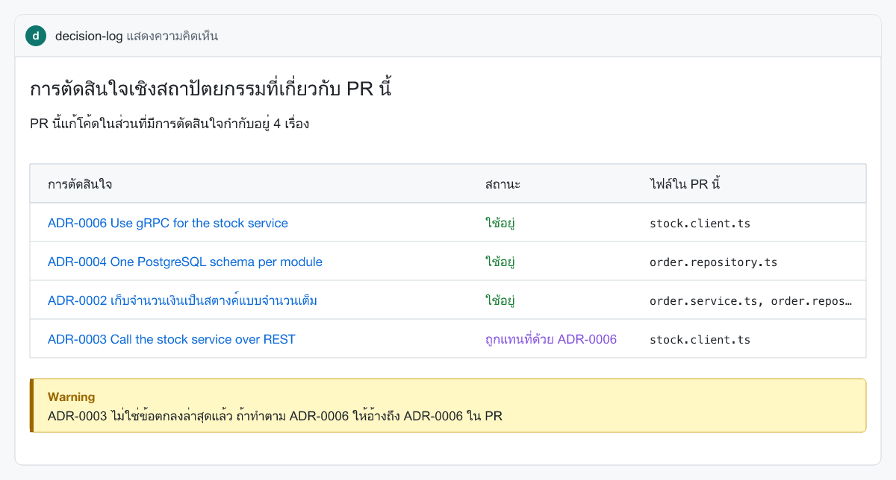

# decision-log

[English](README.md) | ภาษาไทย

บันทึกการตัดสินใจเชิงสถาปัตยกรรม (ADR) ที่มีคนอ่านจริง เพราะมันไปโผล่ใน pull request ที่แก้โค้ดส่วนนั้นพอดี

[](https://github.com/nuttakulsv/decision-log/actions/workflows/ci.yml)
[](https://www.npmjs.com/package/decision-log-cli)
[](LICENSE)



<sub>คอมเมนต์ที่ Action โพสต์ใน pull request ของ [examples/shop-api](examples/shop-api) ที่แก้ stock client กับโมดูล orders วาดจากข้อมูลชุดเดียวกับที่ Action ใช้</sub>

```bash
npx decision-log-cli init --lang th
npx decision-log-cli new "ใช้ PostgreSQL กับระบบออเดอร์" --area "src/orders/**"
npx decision-log-cli affected --base origin/main
```

## หน้าตาตอนใช้งาน

ตัวอย่างจาก [examples/shop-api](examples/shop-api) ซึ่งเป็น backend เล็ก ๆ ที่มีการตัดสินใจ 8 เรื่อง

```console
$ npx decision-log-cli list
ID        STATUS      DATE        TITLE
ADR-0001  accepted    2024-05-06  Record architecture decisions
ADR-0002  accepted    2024-05-20  เก็บจำนวนเงินเป็นสตางค์แบบจำนวนเต็ม
ADR-0003  superseded  2024-06-03  Call the stock service over REST
ADR-0004  accepted    2024-08-12  One PostgreSQL schema per module
ADR-0005  superseded  2024-09-02  Send order notifications with LINE Notify
ADR-0006  accepted    2025-01-20  Use gRPC for the stock service
ADR-0007  accepted    2025-02-10  Send notifications with the LINE Messaging API
ADR-0008  deprecated  2026-05-18  Cache product prices in Redis

$ npx decision-log-cli affected src/clients/stock.client.ts src/orders/order.service.ts
ADR-0006  accepted  Use gRPC for the stock service
    src/clients/stock.client.ts
ADR-0002  accepted  เก็บจำนวนเงินเป็นสตางค์แบบจำนวนเต็ม
    src/orders/order.service.ts
ADR-0003  superseded by ADR-0006  Call the stock service over REST
    src/clients/stock.client.ts

$ npx decision-log-cli check
8 decisions, 0 errors, 0 warnings
```

แต่ละเรื่องบอกว่าคุมโค้ดส่วนไหน ด้วย glob ใน frontmatter

```yaml
---
status: accepted
date: 2024-05-20
deciders: [Ploy, Arm, Bank]
areas:
  - src/shared/money.ts
  - src/orders/**
  - src/payments/**
---
# เก็บจำนวนเงินเป็นสตางค์แบบจำนวนเต็ม
```

## ทำไมถึงทำตัวนี้

ทีมที่ลองเขียน ADR ส่วนใหญ่จะได้โฟลเดอร์เอกสารดี ๆ มาหนึ่งโฟลเดอร์ ที่ไม่มีใครเปิดอ่าน ตัดสินใจกันเสร็จ เขียนบันทึกเสร็จ ผ่านไปหกเดือนก็มีคนกลับไปเขียน stock client เป็น REST ใหม่ เพราะไม่เคยเห็น ADR-0006

ปัญหาไม่ได้อยู่ที่รูปแบบเอกสาร แต่อยู่ที่บันทึกกับงานอยู่กันคนละที่ decision-log เชื่อมสองอย่างนี้เข้าด้วยกัน การตัดสินใจแต่ละเรื่องระบุไฟล์ที่มันคุมอยู่ พอมี pull request มาแก้ไฟล์พวกนั้น การตัดสินใจที่เกี่ยวข้องก็จะไปขึ้นใน PR เลย ถ้าโค้ดส่วนนั้นยังผูกกับเรื่องที่ถูกแทนที่ไปแล้ว คอมเมนต์ก็จะเตือน และถ้าเปิด `fail-on-deprecated` ไว้ check จะไม่ผ่านจนกว่าคนเปิด PR จะอ้างถึงเรื่องล่าสุด

ส่วนที่เหลือคือเครื่องมือพื้นฐานที่ต้องมีถ้าจะดูแลบันทึกการตัดสินใจให้ใช้ได้ยาว ๆ มี CLI สำหรับสร้างและแทนที่บันทึก มีตัวตรวจไว้รันใน CI และมีหน้าเว็บไว้เปิดดู

## ติดตั้ง

```bash
npm install --save-dev decision-log-cli
npx decision-log-cli --help
```

คำสั่งที่ติดตั้งมาชื่อ `decision-log` เวลาเขียน script ใน `package.json` ใช้ `"adr": "decision-log"` ได้เลย แต่ถ้าเรียกผ่าน `npx` ให้ใช้ชื่อแพ็กเกจ `decision-log-cli` เพราะบน npm มีแพ็กเกจอื่นใช้ชื่อ `decision-log` อยู่

ใช้ Node.js 20 ขึ้นไป แพ็กเกจมี dependency เล็ก ๆ 3 ตัว (`yaml`, `picomatch`, `marked`) ส่วน GitHub Action ไม่ต้องติดตั้งอะไรเพิ่ม

## คำสั่ง

| คำสั่ง                                                                                                            | ทำอะไร                                                                                                                |
| ----------------------------------------------------------------------------------------------------------------- | --------------------------------------------------------------------------------------------------------------------- |
| `init [--lang en\|th] [--dir <dir>]`                                                                              | สร้าง `decision-log.json` และบันทึกเรื่องแรก "บันทึกการตัดสินใจเชิงสถาปัตยกรรม"                                       |
| `new "<ชื่อเรื่อง>" [--area <glob>]... [--tag <t>]... [--decider <ชื่อ>]... [--supersedes <n>]... [--status <s>]` | สร้างไฟล์เลขถัดไปจาก template ถ้าใส่ `--supersedes` จะไปแก้บันทึกเก่าให้ด้วย                                          |
| `list [--status <s>] [--json]`                                                                                    | ตารางการตัดสินใจทั้งหมด                                                                                               |
| `status <n> proposed\|accepted\|rejected\|deprecated`                                                             | เปลี่ยนสถานะและวันที่                                                                                                 |
| `supersede <เก่า> <ใหม่>`                                                                                         | ตั้งให้เรื่องเก่าถูกแทนที่ด้วยเรื่องใหม่ และลิงก์สองไฟล์เข้าหากัน                                                     |
| `check [--strict]`                                                                                                | ตรวจทั้งโฟลเดอร์ มี error ออกด้วย exit code 1 ถ้าใส่ `--strict` warning ก็นับด้วย รันใน Actions จะขึ้นเป็น annotation |
| `affected <ไฟล์>... \| --base <ref> [--json] [--markdown]`                                                        | เรื่องที่คุมไฟล์ที่ระบุ หรือไฟล์ที่เปลี่ยนตั้งแต่ `<ref>`                                                             |
| `site [-o dist] [--title <t>] [--source-url <url>]`                                                               | สร้าง `index.html` ไฟล์เดียว ค้นหาและกรองตามสถานะหรือ area ได้                                                        |
| `migrate [--write]`                                                                                               | แปลงไฟล์แบบ adr-tools และ log4brains ให้มี frontmatter ถ้าไม่ใส่ `--write` จะแค่แสดงว่าจะแก้อะไร                      |

ทุกคำสั่งใส่ `-C <dir>` เพื่อรันกับโฟลเดอร์อื่นได้

`check` ตรวจอะไรบ้าง

| Error                                                               | Warning                                                             |
| ------------------------------------------------------------------- | ------------------------------------------------------------------- |
| ไม่มีสถานะ หรือสถานะไม่รู้จัก, ไม่มีวันที่ หรือวันที่ผิดรูปแบบ      | เลขข้าม                                                             |
| สองไฟล์ใช้เลขเดียวกัน                                               | มี `supersedes` แต่อีกไฟล์ไม่มี `superseded_by` คู่กัน              |
| `supersedes` / `superseded_by` ชี้ไปเรื่องที่ไม่มีอยู่              | glob ใน `areas` ไม่ตรงกับไฟล์ไหนใน repo แล้ว (มักเกิดหลัง refactor) |
| สถานะ `superseded` แต่ไม่มี `superseded_by` หรือกลับกัน             | เรื่องที่ใช้อยู่เลยวัน `review` มาแล้ว                              |
| frontmatter ไม่ใช่ YAML ที่ถูกต้อง, `id` หรือ `title` ไม่ตรงกับไฟล์ | ไฟล์ยังเป็นรูปแบบ adr-tools/log4brains                              |

## รูปแบบไฟล์

การตัดสินใจหนึ่งเรื่องคือไฟล์ Markdown ชื่อ `NNNN-slug.md` เลขมาจากชื่อไฟล์ ชื่อเรื่องมาจากหัวข้อ `#` แรก ([เหตุผล](docs/decisions/0002-number-and-title-come-from-the-file.md)) ที่เหลืออยู่ใน frontmatter

| ช่อง                           | ตัวอย่าง          | หมายเหตุ                                                                                                            |
| ------------------------------ | ----------------- | ------------------------------------------------------------------------------------------------------------------- |
| `status`                       | `accepted`        | `proposed`, `accepted`, `rejected`, `deprecated` หรือ `superseded` เขียนแบบ MADR ว่า `superseded by ADR-0012` ก็ได้ |
| `date`                         | `2026-01-20`      | วันที่แก้ล่าสุด รูปแบบ `YYYY-MM-DD`                                                                                 |
| `deciders`                     | `[Ploy, Arm]`     | อ่าน `decision-makers` แบบ MADR ด้วย                                                                                |
| `areas`                        | `[src/orders/**]` | glob เทียบจาก root ของโปรเจกต์ เรื่องที่ `rejected` จะไม่ถูกจับคู่                                                  |
| `supersedes` / `superseded_by` | `[3]`             | เป็นเลข คำสั่ง `supersede` และ `new --supersedes` แก้ให้ทั้งสองฝั่ง                                                 |
| `tags`                         | `[database]`      | ข้อความอิสระ ใช้ค้นหาในหน้าเว็บ                                                                                     |
| `review`                       | `2027-01-01`      | ไม่ใส่ก็ได้ `check` จะเตือนเมื่อเรื่องที่ใช้อยู่เลยวันนี้ไปแล้ว                                                     |

`new` ใช้ template ที่อิงโครงของ [MADR](https://adr.github.io/madr/) มีตารางเทียบ trade-off ของแต่ละทางเลือก มีทั้งภาษาอังกฤษและไทย (`--lang th` หรือใส่ `"lang": "th"` ใน `decision-log.json`) ชื่อไฟล์เก็บตัวอักษรไทยไว้ เช่น `new "เก็บเงินเป็นสตางค์"` จะได้ `0002-เก็บเงินเป็นสตางค์.md`

ลำดับการหาโฟลเดอร์ คือ `decision-log.json`, `.adr-dir` ของ adr-tools, `.log4brains.yml` ของ log4brains แล้วค่อยดู `docs/decisions`, `docs/adr`, `doc/adr` หรือ `docs/architecture/decisions`

## GitHub Action

```yaml
# .github/workflows/decisions.yml
name: Decisions
on: pull_request

permissions:
  contents: read
  pull-requests: write

jobs:
  decisions:
    runs-on: ubuntu-latest
    steps:
      - uses: actions/checkout@v7
      - uses: nuttakulsv/decision-log@v0
        with:
          lang: th
          fail-on-deprecated: false
```

Action ดึงรายชื่อไฟล์ที่เปลี่ยนผ่าน API (ไม่ต้อง clone ประวัติทั้งหมด) เทียบกับ `areas` แล้วอัปเดตคอมเมนต์เดิมใน PR อันเดียว ไม่โพสต์ใหม่ทุกครั้งที่ push ถ้าไม่มีเรื่องไหนเกี่ยวก็จะเงียบไป เนื้อหาเดียวกันจะขึ้นใน job summary ด้วย

| Input                | ค่าเริ่มต้น                              |                                                                                                                                                                                                                                |
| -------------------- | ---------------------------------------- | ------------------------------------------------------------------------------------------------------------------------------------------------------------------------------------------------------------------------------ |
| `github-token`       | `${{ github.token }}`                    | ต้องมีสิทธิ์ `pull-requests: write` ถึงจะคอมเมนต์ได้                                                                                                                                                                           |
| `dir`                | หาเอง                                    | โฟลเดอร์ที่เก็บการตัดสินใจ                                                                                                                                                                                                     |
| `lang`               | ตาม `decision-log.json` ถ้าไม่มีใช้ `en` | ภาษาของคอมเมนต์                                                                                                                                                                                                                |
| `fail-on-deprecated` | `false`                                  | ให้ job ไม่ผ่าน ถ้า PR แก้โค้ดที่ผูกกับเรื่องที่ถูกแทนที่หรือเลิกใช้แล้ว โดยชื่อหรือคำอธิบาย PR ไม่ได้อ้างถึงเรื่องล่าสุด (`ADR-12`, `ADR-0012` หรือ `decision 12`) ถ้าแก้ไฟล์การตัดสินใจนั้นใน PR เดียวกันก็นับว่าอ้างถึงแล้ว |

Output มี `decisions` (JSON array ของเลข) และ `count`

PR ที่มาจาก fork จะได้ token แบบอ่านอย่างเดียว เลยโพสต์คอมเมนต์ไม่ได้ Action จะขึ้น warning และยังเขียน job summary ให้ เนื่องจาก decision-log อ่านแค่ไฟล์ Markdown ไม่เคยรันโค้ดจาก PR ถ้าอยากได้คอมเมนต์ใน PR จาก fork จะรันบน `pull_request_target` ก็ได้ ซึ่งจะอ่านการตัดสินใจจาก branch หลักแทน

ตัว Action เป็นไฟล์ bundle ไฟล์เดียวที่ commit ไว้ใน repo นี้ เลยเริ่มทำงานได้ทันทีโดยไม่ต้องติดตั้งอะไร ([เหตุผล](docs/decisions/0004-ship-the-action-as-a-committed-bundle.md))

### ตรวจใน CI

```yaml
- run: npx decision-log-cli check --strict
```

### เอาหน้าเว็บขึ้น GitHub Pages

```yaml
- run: npx decision-log-cli site -o site --title "Shop API decisions" --source-url "https://github.com/${{ github.repository }}/blob/main"
- uses: actions/upload-pages-artifact@v5
  with:
    path: site
```

หน้าเว็บเป็น HTML ไฟล์เดียว ไม่โหลดอะไรจากข้างนอก มีโหมดสว่างและมืด ใช้ฟอนต์ของระบบที่แสดงภาษาไทยได้ดี เปิดผ่าน `file://` ก็ได้

## ย้ายมาจาก adr-tools หรือ log4brains

ไม่ต้องย้ายก็ได้ ไฟล์ทั้งสองแบบอ่านได้ตามเดิม ทั้งบรรทัด `Date:` และหัวข้อ `## Status` ที่มีลิงก์ `Supersedes [2. ...](0002-...)` ของ adr-tools และรายการ `- Status: accepted` ของ log4brains `check` จะเตือนว่าเป็นรูปแบบเก่า และ `areas` ใช้ได้กับไฟล์ที่มี frontmatter เท่านั้น

ถ้าจะแปลง

```console
$ npx decision-log-cli check
doc/adr/0001-record-architecture-decisions.md: warning: no frontmatter (adr-tools/log4brains style); run "decision-log migrate" to convert
doc/adr/0002-use-rest-for-http-2-clients.md: warning: no frontmatter (adr-tools/log4brains style); run "decision-log migrate" to convert
doc/adr/0003-use-grpc.md: warning: no frontmatter (adr-tools/log4brains style); run "decision-log migrate" to convert
3 decisions, 0 errors, 3 warnings

$ npx decision-log-cli migrate --write
migrated doc/adr/0001-record-architecture-decisions.md (accepted)
migrated doc/adr/0002-use-rest-for-http-2-clients.md (superseded)
migrated doc/adr/0003-use-grpc.md (accepted)

$ npx decision-log-cli check
3 decisions, 0 errors, 0 warnings
```

`migrate` ย้ายสถานะ วันที่ ผู้ตัดสินใจ tag และลิงก์ supersede ไปไว้ใน frontmatter แล้วลบบรรทัดพวกนั้นออกจากเนื้อหา ข้อความส่วนอื่นไม่ถูกแตะ commit ไว้ก่อนรันจะได้ดู diff ได้

## คำถามที่พบบ่อยและข้อจำกัด

**ทำไมใช้ glob แทนการเขียน `// ADR-0006` ไว้ในโค้ด** เพราะขอบเขตถูกกำหนดโดยคนที่ตัดสินใจ ใน review รอบเดียวกัน และ `check` รู้ได้ว่า glob ไหนไม่ตรงกับอะไรแล้ว ส่วนคอมเมนต์ในโค้ดจะค่อย ๆ ผิดไปเงียบ ๆ รายละเอียด trade-off อยู่ใน [ADR-0003](docs/decisions/0003-link-decisions-to-code-with-globs.md) ของ repo นี้

**บล็อกการ merge ได้ไหม** ได้เฉพาะตอนตั้ง `fail-on-deprecated: true` และเฉพาะโค้ดที่ผูกกับเรื่องที่ถูกแทนที่หรือเลิกใช้แล้ว การตัดสินใจใหม่ไม่บล็อกอะไรเลย ([ADR-0005](docs/decisions/0005-comment-by-default-fail-only-when-asked.md))

**ใช้กับ GitLab หรือ Bitbucket ได้ไหม** CLI ใช้ได้ทุกที่ คำสั่ง `affected --base origin/main --markdown` พิมพ์คอมเมนต์แบบเดียวกันออกมา เอาไปโพสต์จาก CI ไหนก็ได้ มีแค่ Action ที่ใช้ได้เฉพาะ GitHub

**ข้อจำกัด**

- glob จับระดับไฟล์ ถ้าการตัดสินใจพูดถึงแค่ฟังก์ชันเดียว ก็จะคุมทั้งไฟล์
- เปลี่ยนชื่อไฟล์การตัดสินใจแล้วเลขจะเปลี่ยนตาม `check` จะเจอเลขซ้ำและลิงก์ที่เสียหลังจากนั้น
- `--supersedes` ตั้งเรื่องเก่าเป็น superseded ทันที แม้เรื่องใหม่ยังเป็น proposed อยู่
- หน้าเว็บแสดง Markdown ตามที่เขียน รวมถึง HTML ที่ใส่ไว้ เหมาะกับบันทึกใน repo ของทีมเอง

## ขอบคุณ

- บทความ [Documenting Architecture Decisions](https://cognitect.com/blog/2011/11/15/documenting-architecture-decisions) ของ Michael Nygard ที่เป็นจุดเริ่มของแนวทางนี้
- template อิงโครงของ [MADR](https://github.com/adr/madr) ซึ่งใช้ license MIT หรือ CC0 ส่วนตาราง trade-off และฉบับภาษาไทยเราทำเพิ่มเอง
- [adr-tools](https://github.com/npryce/adr-tools) และ [log4brains](https://github.com/thomvaill/log4brains) ที่กำหนดรูปแบบไฟล์ซึ่ง decision-log อ่านได้ ไม่ได้ใช้โค้ดของทั้งสองโปรเจกต์

repo นี้เก็บการตัดสินใจของตัวเองไว้ใน [docs/decisions](docs/decisions) และ CI ก็รัน Action นี้กับทุก pull request

## ร่วมพัฒนา

ดู [CONTRIBUTING.md](CONTRIBUTING.md) เปิด issue หรือ pull request เป็นภาษาไทยหรืออังกฤษก็ได้

## License

[MIT](LICENSE)
